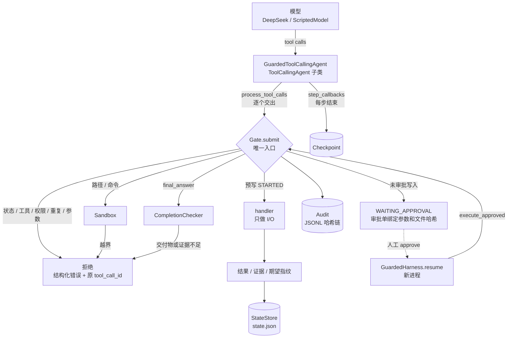

# Week 03 · 基于 smolagents 的 Guarded Coding Harness

AI Agent 全栈工程师训练营作业三。要求是在**不重写 smolagents 核心**的前提下，给 `ToolCallingAgent` 加一层可恢复的 Guarded Coding Harness：
模型继续负责决策，程序负责门禁、执行边界、状态、审计、恢复和最终验收，让 Agent 能安全完成“代码理解”和“测试修复”两类仓库任务。

结果一览：

- `pytest -q`：**90 passed**，连续 3 次结果一致，不依赖真实模型（见 [records/pytest_result.txt](records/pytest_result.txt)）
- 离线完整流程：脚本模型 + 4 个独立进程，覆盖越界拦截、审批、恢复、Ctrl-C 中断、重复写入被拒和最终验收
- 真实模型（DeepSeek `deepseek-flash`）跑通一次测试修复：5 个会话、3 次人工审批后验收通过；diff、测试证据、审计三方哈希互相印证

---

## 快速开始

需要 Python 3.11+。

```bash
uv venv --python 3.12 .venv
uv pip install --python .venv/bin/python "smolagents[openai]==1.26.0" pydantic pytest
```

跑全部测试（离线，Fake Model）：

```bash
.venv/bin/python -m pytest -q
```

离线演示（脚本模型，重新生成 `records/` 里的离线记录）：

```bash
.venv/bin/python scripts/offline_demo.py
```

用真实模型跑一次测试修复（读取环境变量 `DEEPSEEK_API_KEY`，可选 `DEEPSEEK_MODEL`、`DEEPSEEK_BASE_URL`）：

```bash
.venv/bin/python harness_cli.py prepare --name mine
```

```bash
.venv/bin/python harness_cli.py run --workspace workspaces/mine --kind test_fix --task "修复失败的测试" --model deepseek --verbose
```

运行停在 `WAITING_APPROVAL` 时，命令行会打印 diff 和下一步命令。批准后在新进程里恢复：

```bash
.venv/bin/python harness_cli.py approve <run_id> apr_0001 --actor <你的名字>
```

```bash
.venv/bin/python harness_cli.py resume <run_id> --model deepseek
```

生成运行记录（diff、证据、互证检查、检查点、审计决策链）：

```bash
.venv/bin/python harness_cli.py report <run_id> --out records/my_run.md
```

其他子命令：`reject`（驳回审批）、`verify`（核对结果未知的动作）、`ack-workspace`（确认工作区外部改动）、`status`、`audit [--tool-call-id] [--verify]`。

---

## 架构



一次工具调用在 Gate 里的检查顺序是固定的。任何一步不通过，都不会进入 handler：

| # | 检查 | 拒绝码 | 对应验收 |
|---|---|---|---|
| 1 | run 必须是 RUNNING（等待审批后，同一步里后面的调用也不执行） | `RUN_NOT_ACTIVE` / `CANCELLED` | G3 |
| 2 | 工具存在 | `UNKNOWN_TOOL` | |
| 3 | 当前任务类型允许用这个工具 | `PERMISSION_DENIED` | |
| 4 | 连续第 3 次相同工具 + 相同参数 | `REPEATED_CALL` | G2 |
| 5 | 参数 schema（严格模式：缺字段、类型错、多字段） | `INVALID_ARGUMENTS` | G1 |
| 6 | Sandbox：路径真实落点、敏感目录、只读与可写范围、命令白名单 | `PATH_ESCAPE` / `SYMLINK_ESCAPE` / `SENSITIVE_PATH` / `READONLY_PATH` / `COMMAND_NOT_ALLOWED` | S1–S3 |
| 7 | 工具调用预算 | `BUDGET_EXHAUSTED` | H3 |
| 8 | 写入幂等：相同写入已生效且文件未变 | `DUPLICATE_WRITE` | G4 |
| 9 | 写入审批 → run 进入 `WAITING_APPROVAL` | `APPROVAL_REQUIRED` | G3 |
| 10 | `final_answer` 交给完成验收 | `COMPLETION_REJECTED` | H1 / H2 |
| 11 | 执行：先落盘 `STARTED`（预写），再调 handler，再落盘结果 | `TIMEOUT` / `CANCELLED` 等 | C2 / S4 |

模型看到的观察结果都是同一种结构（第一行 JSON，大段文本附在后面）：

```json
{"tool_call_id": "call_02", "tool": "read_file", "ok": false, "decision": "deny",
 "error": {"code": "PATH_ESCAPE", "rule": "sandbox.path_escape",
           "message": "path 'artifacts/../../.env' resolves outside the workspace",
           "details": {"raw": "artifacts/../../.env"}}}
```

### 没有重写 smolagents：只用了这些扩展点

| 扩展点 | 做法 | 为什么 |
|---|---|---|
| `process_tool_calls` | 子类覆盖：逐个把 tool call 交给 Gate，产出的 `ToolCall` / `ToolOutput` 与原实现一致 | 原实现直接并行调用 tool，拿不到 `tool_call_id`，也没有门禁 |
| `execute_tool_call` | 子类覆盖：直接抛 `GateBypassError` | 堵住绕过 Gate 的执行路径 |
| `_handle_max_steps_reached` | 子类覆盖：抛出 `MAX_STEPS` 停止 | 原实现会再调一次模型“总结”出一个答案并当作成功返回（H3） |
| `step_callbacks` | 每步结束记步骤、算预算、存检查点 | 这里就是安全步骤边界（C1） |
| `interrupt()` | 等待审批、预算耗尽、用户取消时调用 | 在步骤边界干净地停下 |
| `final_answer_checks` | 兜底：只有 Gate 已验收（COMPLETED）才允许结束 | 双保险 |
| `memory.steps` + `run(reset=False)` | 从检查点重建 `TaskStep` / `ActionStep`，带恢复说明继续跑 | 新进程恢复后，模型能看到中断前的对话 |
| `Tool`（动态子类） | 只携带 schema，`forward` 永远抛错 | 模型看得到工具定义，但工具对象本身执行不了任何事 |

`GuardedToolCallingAgent.run()` 只能在 `GuardedHarness._drive()` 里调用，直接调用会报错。所以 Agent 只有一条运行入口。

---

## 交付物

| 交付物 | 最低职责 | 实现要点 |
|---|---|---|
| [gate.py](gate.py) | 所有 Tool Call 的唯一入口 | 固定顺序的 11 步检查；拒绝时返回结构化错误和原 `tool_call_id`；审批单一次性、执行前即消费；执行前预写 `STARTED`；证据记录和失效统一在这里处理 |
| [sandbox.py](sandbox.py) | 路径、敏感目录、命令白名单、超时、环境变量、输出边界 | 三层路径校验（词法归一化 → `realpath` 真实落点 → 敏感 / 只读）；pytest 选项走白名单、不经过 shell；独立进程组，超时或取消时 SIGTERM → SIGKILL 整组；子进程只拿白名单环境变量；输出脱敏并保留头尾 |
| [state_store.py](state_store.py) | 保存 Run、计划、步骤、证据、预算、审批、停止原因 | pydantic 模型 + 原子落盘（临时文件 → fsync → rename）；状态机校验迁移；进程锁；写前原件用于生成 diff |
| [checkpoint.py](checkpoint.py) | 在安全步骤边界保存和恢复 | 有动作在执行时拒绝存检查点；带 checksum，损坏就退回上一个；`plan_recovery()` 是纯函数，算出结果未知、漂移、作废审批等 |
| [audit.py](audit.py) | append-only 记录 | JSONL + 哈希链 + `flock`；只有 `append` / `records` / `decision_chain` / `verify` 四个公开方法 |
| [harness.py](harness.py) | 装配与完成检查、唯一运行入口 | `start` / `resume` / `approve` / `reject` / `resolve_unknown` / `acknowledge_workspace` / `cancel`；任务画像决定工具和读写范围 |
| [completion.py](completion.py) | 完成验收 | 只看事实：工作区快照、证据的代码指纹，不看模型怎么说 |
| [coding_tools.py](coding_tools.py) | 8 个工具 | 参数模型 + 只做 I/O 的 handler；路径参数、命令参数、是否审批、产生什么证据，都在 `ToolSpec` 里声明 |
| [tests/](tests/) | Fake Model 覆盖正常与失败路径 | 90 个用例，`ScriptedModel` 离线驱动，含真实子进程的跨进程恢复测试 |

辅助文件：[fake_model.py](fake_model.py)（脚本模型）、[harness_cli.py](harness_cli.py)（命令行入口与运行记录生成）、[demo_repos/shop](demo_repos/shop)（演示仓库，埋了两个 bug：折扣档位 `>` 应为 `>=`，舍入应为 `ROUND_HALF_UP`）、[scripts/offline_demo.py](scripts/offline_demo.py)。

两类任务的画像：

| | code_understanding | test_fix |
|---|---|---|
| 可用工具 | 读、搜、列目录、跑测试、写报告、计划、答案 | 全部 8 个 |
| 可写范围 | 只有 `artifacts/` | 除 `tests/`、`conftest.py`、`pytest.ini`、`pyproject.toml` 等测试配置外 |
| 审批 | 写 `artifacts/` 免审批 | 写源码要审批 |
| 验收 | 本次写出的报告、足够篇幅、读过 ≥2 个文件、报告引用了读过的文件 | 源码有改动、没动测试、**当前代码版本**上有一次通过的**完整**测试 |

---

## 核心验收对照

所有 P0 场景都有确定性测试。下表列出测试名（文件见括号）和关键断言。

| 编号 | 场景 | 测试 | 关键断言 |
|---|---|---|---|
| G1 | 参数缺字段或类型错误 | `test_g1_*`（test_gate） | 6 种非法参数 + 半截 JSON 都返回 `INVALID_ARGUMENTS`，逐字段列出；handler 计数 0；模型下一轮看到的观察里带原 `tool_call_id` |
| G2 | 连续三次相同调用 | `test_g2_*`（test_gate） | 第 3 次 `REPEATED_CALL`，handler 计数 2；中间插一个不同调用就重新计数；跨步骤累计 |
| G3 | 未审批的写操作 | `test_g3_*`（test_gate） | `WAITING_APPROVAL`，目标文件字节不变，同一步后续调用 `RUN_NOT_ACTIVE`；`artifacts/../src/x.py` 骗不过免审批前缀 |
| G4 | 审批后重复执行 | `test_g4_approved_write_runs_once_and_repeats_are_rejected` | 写入只执行 1 次；模型重发 → `DUPLICATE_WRITE`；再次 resume 不重放；直接重用审批单 → `APPROVAL_CONSUMED` |
| S1 | `artifacts/../../.env` 路径逃逸 | `test_s1_*`（test_sandbox） | `PATH_ESCAPE`，读写 handler 都不执行，工作区外的 `.env` 未被读写；错误信息不泄露宿主机绝对路径 |
| S2 | 软链接逃逸、敏感目录 | `test_s2_*`（test_sandbox） | 用真实落点判定 `SYMLINK_ESCAPE`；名字无害但指向 `.env` 的软链接 → `SENSITIVE_PATH`；`.ENV`、`.git`、`*.pem` 等；审计里记下真实落点 |
| S3 | `run_test` 配置外命令 | `test_s3_*`（test_sandbox） | 13 种危险命令按规则拒绝（非 pytest、`;` `&&` `$()` `>`、`--rootdir`、`-p`、`-c`、越界路径）；用 `touch pwned` 哨兵验证命令根本没启动 |
| S4 | 超时或用户取消 | `test_s4_*`（test_sandbox） | 子进程和它 fork 的孙进程都被 `os.kill(pid, 0)` 确认已终止；分别在 Sandbox 层和 Gate + Harness 端到端两层验证 |
| C1 | 每步保存 Checkpoint | `test_c1_*`（test_state_checkpoint） | 每步一个检查点；内含 run、step、计划、证据、预算、待审批动作（含完整参数）和对话记忆；有动作在执行时拒绝存检查点 |
| C2 | 写入完成但结果未保存 | `test_c2_write_done_but_result_not_saved_is_unknown_and_never_replayed` | 新实例恢复 → `UNKNOWN_RESULT` / `WAITING_VERIFICATION`，模型调用 0 次，写入不重放；人工 `verify` 后继续 |
| C3 | 正常中断后换进程恢复 | `test_c3_resume_in_new_processes_keeps_progress_counters_and_writes_once` | 4 个真实子进程；步号 1–8 连续、会话 1/2/3，工具调用累计 6；整个运行只写入 1 次；恢复后的模型看到之前的对话 |
| C4 | 恢复时工作区已变化 | `test_c4_workspace_changed_while_paused_invalidates_evidence_and_approvals` | `WORKSPACE_CHANGED` 停下，模型调用 0 次；已批准的审批变 `STALE` 且不执行；读取和测试证据失效；人工确认后旧审批也不会复活 |
| A1 | 查看一次被拒绝的调用 | `test_a1_*`（test_audit） | 记录含 `run_id`、`tool_call_id`、`rule`、`decision`、`actor`（审计 JSON 字段用 snake_case：`tool_call_id` 即 toolCallId） |
| A2 | 查看一次完整任务 | `test_a2_*`（test_audit） | 写入调用的决策链按顺序是：Sandbox → Gate(pending) → 审批申请 → 状态迁移 → `human:alice` 批准 → 再查 Sandbox → 审批消费 → Gate(allow) → 执行 → 证据 → 结果；审批单号、动作号、哈希和状态互相对应 |
| H1 | 说完成但无交付物 | `test_h1_*`（test_completion） | `COMPLETION_REJECTED`，列出未通过的检查项，不进入完成态；两类任务都覆盖 |
| H2 | 测试通过后又改源码 | `test_h2_*`（test_completion） | 旧证据标记失效（原因：`cart.py modified by e1`），答案被拒；重跑后通过。只跑部分测试不算；绕过 Harness 的改动也会让验收失败 |
| H3 | 最大轮数或预算 | `test_h3_*`（test_completion） | `MAX_STEPS` / `BUDGET_EXHAUSTED`（tokens、tool_calls），`success=False`，`final_answer=None`；模型调用次数等于步数，不再“编一个答案”；终态不能 resume |
| T1 | 运行完整测试集 | 全部 | 90 passed，连续 3 次一致，约 10 秒 |
| T2 | 真实模型跑通一类任务 | [records/run_record_deepseek.md](records/run_record_deepseek.md) | 见下文 |

另有：`test_harness_loop.py` 覆盖两类任务的正常路径、驳回审批、`final_answer` 与其他调用混在同一步、模型调用失败后恢复、测试运行中 Ctrl-C；`test_audit.py` 覆盖篡改、删除、调换顺序的检测，以及两个写入方并发追加。

---

## 提交材料

| 要求 | 文件 |
|---|---|
| 源码与测试 | 根目录各模块 + [tests/](tests/) |
| `pytest -q` 实际结果 | [records/pytest_result.txt](records/pytest_result.txt) |
| 完整运行记录 | 离线：[records/run_record_offline.md](records/run_record_offline.md)；真实模型：[records/run_record_deepseek.md](records/run_record_deepseek.md)，以及 `records/deepseek_session1..5.log`（各会话的 smolagents 逐步日志） |
| 审计记录 | [records/audit_offline.jsonl](records/audit_offline.jsonl)（66 条）、[records/audit_deepseek.jsonl](records/audit_deepseek.jsonl)（132 条），哈希链校验通过 |
| Checkpoint 恢复记录 | [records/checkpoint_recovery.md](records/checkpoint_recovery.md) |

### T2：真实模型那一次

DeepSeek `deepseek-flash`，任务是修复 `demo_repos/shop` 的失败测试。整个过程是 5 个独立进程：

1. **会话 1**：模型调用直接报 400（思考模式不支持 smolagents 默认的 `tool_choice="required"`）。Harness 记为 `FAILED / MODEL_ERROR`，消耗 1 步。
2. **会话 2**：把 `tool_choice` 改为 `auto` 后，对同一个 run 执行 `resume`。模型先跑测试复现（5 failed），读源码和测试，然后在一步里发出 3 个 `replace_in_file`：第 1 个进入审批，后 2 个被 `RUN_NOT_ACTIVE` 拦下。
3. **会话 3 和 4**：每次批准后恢复，Harness 先执行已批准的修改，模型再提出下一处。
4. **会话 5**：最后一处批准后，模型重跑完整测试集（12 passed），`final_answer` 验收通过。

运行记录里的“互证检查”全部通过：`pricing.py` 的当前哈希、状态期望哈希、审计最后一次写入的哈希三者一致；最后一次通过的完整测试的代码指纹等于当前代码指纹；审计哈希链校验通过。DeepSeek 改出的 `pricing.py` 和离线脚本版逐字节相同（哈希都是 `f2f4f1e4…`）。

审批人记为 `claude-operator`：这次真实运行的审批是我（Claude）在会话里作为操作员执行的，审计里如实记录，没有冒用你的名字。你可以按“快速开始”的命令自己审批重跑一遍。

---

## 设计取舍

- **串行执行工具调用。** smolagents 原本会并行执行同一步里的多个调用。改成串行后，审批、预写记录、检查点都有清晰的先后，代价是同一步里的读操作不能并发。
- **审批由 Harness 执行，不等模型重发。** 审批单绑定完整参数、参数哈希和目标文件哈希；resume 时 Harness 直接经 Gate 执行。执行前先把审批标成 `CONSUMED`：即使执行中途崩溃，这张单也不会被用第二次，结果交给 `UNKNOWN_RESULT` 流程核对。
- **一次只有一个待审批写入。** 某个写入进入审批后，同一步里后面的调用都被 `RUN_NOT_ACTIVE` 拒绝。真实运行里这导致三处小修改分了三轮审批。要合并成一轮，需要让后续审批绑定“前一个审批生效后的哈希”，复杂度和风险都更高，这次没做。
- **只有写入会变成 `UNKNOWN_RESULT`。** 读文件、跑测试中断后可以安全重做，恢复时直接记为失败并继续。测试若改了文件，会被工作区漂移检测发现。
- **证据的新鲜度靠代码指纹。** 测试证据绑定“运行那一刻的代码指纹”。验收时重新拍快照计算当前指纹，不信任任何缓存的“已通过”标记。写 `artifacts/` 下的报告不改变代码指纹。
- **工作区漂移时，所有未执行的审批都作废。** 人批准时看到的是旧工作区。证据只作废受影响的部分：改到的文件的读取证据，以及代码有变化时的全部测试证据。
- **被 Ctrl-C 打断的那一步也计入步数。** 模型调用可能已经发生并计费。
- **测试命令固定为当前解释器加 `-p no:cacheprovider`。** 不在工作区里写 `.pytest_cache`，`PYTHONDONTWRITEBYTECODE=1` 也不写 `__pycache__`，测试运行本身不会造成“漂移”。

## 已知局限

- **没有操作系统级隔离。** `run_test` 会执行仓库代码，包括模型改过、人工批准过的代码。Sandbox 能管住工具层面的路径和命令，但管不住被测代码自己去读写文件或访问网络。目前靠“写源码必须审批”、环境变量白名单、进程组终止和审计兜底；生产环境应把 `Sandbox.run` 换成容器、`bubblewrap` 或 `sandbox-exec`。
- **进程组是终止边界。** 子进程如果自己 `setsid` 脱离进程组，就不在终止范围内，这同样需要操作系统级隔离（cgroup 等）来解决。
- **`search_code` 用 Python `re`，没有超时。** 只扫描每行前 500 字符、最多返回 100 条，病态正则仍可能变慢。
- **快照每次都完整哈希一遍工作区。** 小仓库没问题；大仓库可以按 `(mtime, size, inode)` 做缓存。

---

## 项目结构

```
.
├── gate.py              所有工具调用的唯一入口（915 行，含注释）
├── sandbox.py           执行边界：路径、敏感目录、命令白名单、进程组、环境变量、输出
├── state_store.py       业务状态模型、状态机、原子落盘、进程锁
├── checkpoint.py        检查点、smolagents 记忆序列化、恢复计划
├── audit.py             append-only 审计（JSONL + 哈希链）
├── harness.py           装配、唯一运行入口、恢复、人工操作
├── completion.py        完成验收
├── coding_tools.py      8 个工具的参数模型与 handler
├── fake_model.py        脚本模型（实现 smolagents Model 接口）
├── harness_cli.py       命令行入口 + 运行记录生成
├── scripts/offline_demo.py   离线跨进程演示，生成 records/ 里的离线记录
├── demo_repos/shop/     演示仓库（两个 bug，5 failed / 7 passed）
├── tests/               90 个测试（support.py 是公共夹具）
└── records/             提交用的运行记录、审计、恢复记录、pytest 结果
```

运行时目录 `.harness/`（状态、检查点、审计）和 `workspaces/`（演示仓库副本）已加入 `.gitignore`；提交用的副本都在 `records/`。
